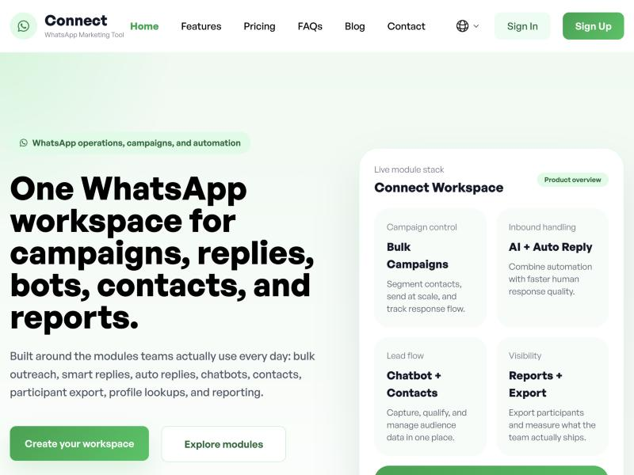

# Connect — WhatsApp Marketing & Automation Platform

> One WhatsApp workspace for campaigns, replies, bots, contacts, and reports.

**Connect** is a multi-tenant SaaS platform I designed, built, and operate under TapCards LLC. It gives businesses a single place to run WhatsApp at scale — bulk campaigns, chatbots, a shared team inbox, contact management, and reporting — plus a deep **WooCommerce integration** that turns a store's order events into automated WhatsApp journeys.

🔗 **Live:** [connect.tapcardss.com](https://connect.tapcardss.com)

> This repository is a **case study** — the product is commercial, so the source isn't published here. It documents what the platform does and the engineering I built.

---

## What it does

- **Bulk campaigns** — segment contacts, send at scale, and track delivery/response flow.
- **Chatbots & auto-reply** — keyword and flow-based bots, with an AI smart-reply option.
- **Shared team inbox (Live Chat)** — agents handle conversations together, with assignment, canned replies, and agent performance reporting.
- **Contacts & segmentation** — dynamic audiences (new / repeat / VIP / inactive / COD / by category) driven by real commerce data.
- **Public REST API** — send messages and manage contacts from any external app, authenticated per team.
- **Reports & export** — measure what actually ships.

## Engineering highlights (what I built)

- **Node.js WhatsApp engine ↔ Laravel app** — a background WhatsApp service kept alive by a health-check/keepalive loop, proxied through the Laravel backend so the browser never talks to it directly. Diagnosed and fixed real production issues (session churn, connection-handshake failures) to keep live numbers stable.
- **Shared team inbox** — built the live-chat module end-to-end (data model, conversation/contact/message/label/note entities, inbound webhook ingestion, and the in-chat UI for canned replies + agent assignment).
- **Payments** — hand-built a **Razorpay** payment gateway (hosted payment links, signature verification, webhook-driven plan activation) into the platform's gateway system.
- **Public REST API** — token-authenticated endpoints for sending messages and upserting contacts, designed to be consumed by external integrations.
- **WooCommerce commerce suite** (companion WordPress plugin): abandoned-cart recovery with timed multi-step follow-ups + auto-coupons, order-event automations (new/processing/completed/cancelled/refund/COD/payment reminders), customer sync & segmentation, and a chatbot that answers live **order-status and product lookups** from the store.
- **SEO/GEO foundation** — canonical/OG/Twitter metadata, JSON-LD schema, sitemap/robots, and AI-crawler access, built into the guest theme.

## Tech

**PHP · Laravel · Node.js · MySQL · REST APIs · WordPress/WooCommerce · Razorpay**

## My role

Founder & full-stack engineer — product design, backend & integration engineering, deployment, and ongoing operations.

---

© TapCards LLC. "Connect" and its branding belong to TapCards LLC. This case study is for portfolio purposes.
